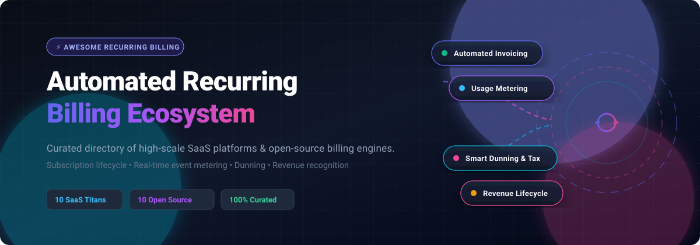

  

# Awesome Automated Recurring Billing 💳 ⚡

  
  
  
  
  
  

> 🚀 **A curated directory of top-tier SaaS platforms and open-source GitHub projects for Automated Recurring Billing, Subscription Management, Real-Time Usage Metering, and Revenue Operations (RevOps).**

---

## 📑 Table of Contents
- [🔍 Sector Overview & Market Dynamics](#-sector-overview--market-dynamics)
- [🏢 SaaS/Hosted Platforms](#-saashosted-platforms)
- [💻 Open-Source GitHub Projects](#-open-source-github-projects)
- [🛠️ Frameworks & Architecture Guide](#️-frameworks--architecture-guide)
- [🤝 How to Contribute](#-how-to-contribute)
- [💖 Support](#-support)
- [📈 Star History](#-star-history)
- [⚖️ Disclaimer](#️-disclaimer)

---

## 🔍 Sector Overview & Market Dynamics

The global subscription billing management software market is valued at approximately **$8.6B to $10.0B in 2026** (projected at a 12%–17% CAGR), embedded within a broader recurring payments transaction ecosystem surpassing $160B. 

The sector is **moderately fragmented**: 
- **Developer-first payment monoliths** (e.g., Stripe) lead checkout-driven, high-velocity subscription setups.
- **Enterprise RevOps platforms** (e.g., Zuora, Chargebee) dominate multi-attribute SaaS subscription lifecycles, ASC 606/IFRS 15 revenue recognition, and hybrid contracting.
- **Modern open-source & usage-metering engines** (e.g., Lago, Flexprice, OpenMeter, Kill Bill) provide self-hosted event metering, transparent double-entry ledgers, and decoupled entitlement layers without per-transaction vendor lock-in.

---

## 🏢 SaaS/Hosted Platforms

| Platform | Company Size (Valuation / Revenue) | Pricing | Free Tier / Free Trial Limit | Key Capabilities |
| :--- | :--- | :--- | :--- | :--- |
| **[Stripe Billing](https://stripe.com/billing)** | **$159B valuation** (~$6.8B net revenue) | **0.7% per transaction** on recurring billing volume (plus standard card processing fees of 2.9% + 30¢) | Free forever full-featured sandbox environment (Test Mode) with Test Clocks; no free production transaction allowance. | Developer-first recurring billing infrastructure with subscription schedules, proration control, threshold billing, and flexible collection methods. |
| **[Chargebee](https://www.chargebee.com/)** | **$3.5B valuation** (~$200M+ ARR) | **$0/mo** (Starter tier up to lifetime cap); paid tiers start at **$599/mo** (Performance tier) | **Free forever up to $250,000 cumulative lifetime billing** (0.75% overage fee applies thereafter); sandbox testing included. | Comprehensive subscription lifecycle management, usage-based charging, tax-inclusive invoicing, GAAP/IFRS revenue recognition (RevRec), and customer retention workflows. |
| **[Zuora](https://www.zuora.com/)** | **$1.7B acquisition valuation** (~$450M revenue) | Starts at **$40,000 – $75,000/year** (annual enterprise contract; no self-serve monthly plan) | No free tier; offers guided product demos and tailored enterprise sandbox test environments upon sales request. | Enterprise subscription order-to-cash platform supporting complex recurring charges, amendments, multi-entity subscription transactions, and automated revenue recognition. |
| **[BillingPlatform](https://billingplatform.com/)** | **$104M total funding** ($90M Series C in 2024; est. $205K+ ACV) | Starts at **~$250/mo** entry level; custom enterprise deployment contracts average **~$205,000/year** | **14-day free trial** test drive with product catalog configuration; no forever-free production tier. | Enterprise revenue lifecycle management recognized in the Gartner Magic Quadrant for Recurring Billing; excels at complex multi-tier usage, mediation, and ERP-integrated hybrid billing. |
| **[Maxio](https://www.maxio.com/)** | **~$50M+ ARR** (merged Chargify & SaaSOptics) | Starts at **$599/mo** (Grow tier for up to $100K/mo in billings) | **Build Plan ($0/mo developer sandbox)** with no expiration for API testing; no free production volume tier. | Billing and financial reporting purpose-built for B2B SaaS with usage-based billing, automated invoicing, GAAP/IFRS revenue recognition, SaaS metrics (NRR, LTV), and dunning. |
| **[Recurly](https://recurly.com/)** | **~$55M+ ARR** (majority owned by Accel-KKR; $40M funding) | Starts at **$249/mo + 0.9%** of billing volume (includes first $40,000/mo billing volume) | **90-day free trial** for platform evaluation; no forever-free production plan. | High-volume subscription management with granular coupon batching, localized payment methods, tax calculation, and AI-powered dunning workflows. |
| **[Ordway](https://ordwaylabs.com/)** | **$32.5M total funding** ($20M round in 2026; $40M Series A valuation) | Starts at **$5,000/year** (~$416/mo baseline platform & implementation fees) | No free tier or public self-serve trial; custom POC and sandbox environments provided during guided sales onboarding. | Integrated billing and payments platform with AutoPay for recurring charges, threshold billing, automated dunning, cash application, and CRM-to-ERP bridge workflows. |
| **[LogiSense](https://logisense.com/)** | **~$5M – $7M ARR** (bootstrapped/enterprise) | Starts at **$5,000/year** platform baseline (scales with consumption & mediation tiers) | **30-day free trial** sandbox for platform evaluation and mediation testing; no forever-free tier. | Usage-based billing and monetization platform with consumption drawdown, rating engines, price books, state-based subscriptions, and automated bill runs. |
| **[Rebilly](https://www.rebilly.com/)** | **~$6.4M ARR** (independent / bootstrapped) | Starts at **$15/mo** (Basic) or **$125/mo** (Pro) + 1% revenue share ($0 Rebilly transaction fees) | **30-day free trial** with full feature access on Basic and Pro plans; no forever-free production tier. | Subscription billing and payment orchestration platform with flexible pricing models (fixed, tiered, stair-step, volume), dunning rules, credit memos, and risk management. |
| **[Nitrobox](https://www.nitrobox.com/)** | **~$3.3M ARR** (Series A funded by Porsche Ventures & NeueCapital) | Custom enterprise quote; base list entry points from **€1,000 – €5,000+/year** platform fee | No self-serve free trial; live 1-on-1 guided proof-of-concept/demo sandbox upon request. | Central European agile monetization platform for platform operators and OEMs, supporting subscription, usage-based, and convergent multi-party invoicing. |

---

## 💻 Open-Source GitHub Projects

Self-hosted, transparent, and auditable billing engines, subscription microservices, and usage-metering frameworks sorted by GitHub star count:

1. **[Lago](https://github.com/getlago/lago)**   
   *Open-source metering and usage-based billing engine.* Built for modern SaaS and developer tools, Lago handles real-time consumption event ingestion, complex pricing tiers, customer wallets/credits, add-ons, and automated invoicing with payment processor integrations.

2. **[Invoice Ninja](https://github.com/invoiceninja/invoiceninja)**   
   *Enterprise-ready self-hosted invoicing and recurring billing suite.* Offers automated recurring invoices, client portals, partial payments, quotes-to-invoices, and integration with 30+ payment gateways for freelancers and scaling businesses.

3. **[Akaunting](https://github.com/akaunting/akaunting)**   
   *Comprehensive open-source online accounting and recurring invoicing software.* Features automated recurring billings, customer subscription tracking, multi-currency ledgers, expense tracking, and financial reporting for small-to-medium businesses.

4. **[Crater](https://github.com/crater-invoice/crater)**   
   *Open-source web and mobile invoicing app.* Features automated recurring invoices, detailed payment tracking, tax estimation, and polished cross-platform client management for freelancers and digital creators.

5. **[Flexprice](https://github.com/flexprice/flexprice)**   
   *Open-source usage-based billing, dynamic pricing, and metering infrastructure.* Designed for AI, API, and cloud services with real-time event aggregation, wallet management, multi-currency invoicing, and self-hosted open-core architecture.

6. **[Kill Bill](https://github.com/killbill/killbill)**   
   *Industrial-strength open-source subscription billing and payments platform.* Enterprise-proven since 2010 with stateful subscription entitlement management, rating and invoicing pipelines, plugins for international gateways, and custom dunning rules.

7. **[OpenMeter](https://github.com/openmeterio/openmeter)**   
   *Cloud-native usage metering and consumption tracking engine.* Ingests millions of raw events per second with sub-second aggregation, real-time balance enforcement, and clean API connectors for Stripe, Lago, and downstream accounting tools.

8. **[Lotus](https://github.com/uselotus/lotus)**   
   *Open-source pricing and packaging control layer for SaaS.* Enables teams to deploy and iterate on recurring subscriptions, hybrid usage tiers, feature entitlements, and pricing experiments without rewriting backend billing code.

9. **[FOSSBilling](https://github.com/FOSSBilling/FOSSBilling)**   
   *Lightweight open-source billing and client management software.* Community-driven solution tailored for web hosts, digital services, and SaaS startups requiring recurring invoices, automated provisioning, and ticketed support.

10. **[Meteroid](https://github.com/meteroid-oss/meteroid)**   
    *Open-source pricing and usage billing platform.* Features event ingestion and deduplication, versioned pricing models, prepaid wallets, proration for upgrades/downgrades, and multi-language automated invoices.

11. **[Tier](https://github.com/tierrun/tier)**   
    *SDK and microservice for pricing, metering, and entitlement enforcement.* Powered by Stripe, Tier lets engineers define pricing plans as code (JSON), track feature limits, and charge recurring fees without rebuilding checkout plumbing.

12. **[Recurso](https://github.com/recurso-dev/recurso)**   
    *Modern open-source (MIT) billing engine written in Go + PostgreSQL.* Features recurring subscriptions, India GST / EU VAT tax engines, smart dunning, 8 usage aggregations, double-entry financial ledger, and zero vendor lock-in.

---

## 🛠️ Frameworks & Architecture Guide

For platform engineering teams rolling out custom billing pipelines without vendor lock-in:
* **Event Ingestion & Usage Metering:** Integrate **OpenMeter** or **Lago** for high-throughput stream processing and event aggregation.
* **Subscription State & Entitlements:** Use **Kill Bill** or **Tier** to manage subscriber lifecycles, grace periods, upgrades, and cancellations.
* **Double-Entry Financial Ledger:** Combine **Recurso** or **PostgreSQL + dbt** models to guarantee auditability, ASC 606 revenue recognition, and ledger integrity.
* **Customer Portal & Invoicing:** Deploy **Invoice Ninja** or **Crater** for customer-facing self-service invoice generation and gateway orchestration.

---

## 🤝 How to Contribute

We welcome contributions from the developer and finance engineering community! 🌟

1. **Fork** the repository.
2. **Add or update** entries in `README.md` following the existing format.
3. Include: Product/Project Name, Official URL / GitHub Repo, concise description, pricing/star badge, and license details.
4. Open a **Pull Request** with a brief summary of the changes.

---

## 💖 Support

If this curated directory has helped you discover billing solutions or save engineering hours, consider supporting this project! ☕

- ⭐ **Star** this repository on GitHub to help others discover it.
- 🍴 **Fork** and contribute open-source billing engines or SaaS benchmarks.
- 📢 **Share** this collection with fellow SaaS founders, finance engineers, and developers.
- ☕ **Sponsor / Buy me a coffee:** Support ongoing open-source curation and maintenance via the [GitHub Sponsor Dashboard](https://github.com/sponsors/ishandutta2007).

---

## 📈 Star History

---

## ⚖️ Disclaimer

- This is a **community-curated list** provided for educational and architectural reference—not financial, legal, or tax advice.
- Automated recurring billing and payment solutions must strictly comply with regional tax regulations (e.g., EU VAT, India GST, US Sales Tax, Peppol e-invoicing mandates) and security frameworks (PCI-DSS Level 1, SOC 1/2, ISO 27001).
- Self-hosted billing software requires proper cryptographic key management, PCI tokenization scope reduction, and financial ledger reconciliation.

---

  <b>Built with ❤️ for SaaS Founders, Finance Engineers, Platform Architects, and Developers.</b> 
  <i>Let's make recurring billing open, reliable, and auditable.</i>

